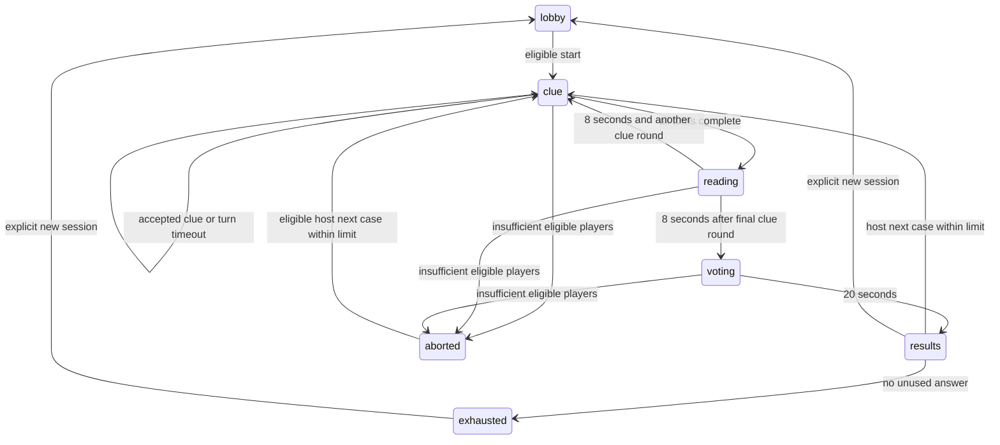

# Perfectly Suspicious game specification

Phase 0 completed on 10 October 2026. Rules revised on 13 October 2026 for sequential turns and host settings. These are project decisions, not CrazyGames rules. Visual work follows the shared UI and UX requirements in the development plan.

## Rules

1. A room supports three to eight eligible human players. Later arrivals spectate the current match.
2. The server chooses one suspicious player and a word using secure randomness. All players see the same category. Only informed players see the word.
3. Before starting, the host chooses 1 to 10 cases, 1 to 5 clue rounds per case and a separate time allowance of 10 to 60 seconds per player for each clue round. Defaults are three cases and two clue rounds with 20 seconds per player in each. Settings are public and locked until a new session.
4. Players submit one at a time. The current player's accepted clue appears immediately for everyone and is final. Submission passes the turn immediately. A timed out turn displays No clue and passes automatically. Unsubmitted drafts stay on that player's device.
5. Turn order reverses in alternating clue rounds and the starting seat rotates between cases. After each complete clue round, eight seconds of reading follow. Every clue round in one case uses the same word. A new case selects a fresh word and roles.
6. Everyone has 20 seconds to vote privately. Votes can be changed before the deadline. Self voting is rejected. A player may abstain.
7. A unique highest vote count identifies the accused. Ties and no votes catch nobody. The suspicious player wins if not accused.
8. An informed player earns 100 points for personally voting for the suspicious player, even if the group tied or accused somebody else. The suspicious player earns 200 points for escaping. All other awards are zero.
9. Results stay until the host selects Next case. Scores accumulate until the chosen case count is reached, when final standings identify the highest score or joint winners. A new session explicitly clears scores and word history while retaining host settings. An aborted case counts toward the case limit and awards no points.

Example: with four players and the fourth suspicious, votes for player four from players one and two award them 100 each. If the group uniquely accuses player four, the suspicious player gets zero. If tied, those correct voters still receive 100 and the suspicious player receives 200. An aborted match awards nothing.

With three players, one is suspicious and two are informed. Both informed players voting for the suspicious player catches that player. A cycle of three different votes is a tie, so the suspicious player escapes. The score table and host settings do not change.

Identical names are allowed. A room assigns every entrant a stable increasing player number. When names match without regard to letter case, their display labels include those numbers. Original names remain intact. Numbers do not change after reconnecting and are not reused when someone leaves. Clues, votes, roles and scores use player IDs rather than names.

## Validation and privacy

English clues use 2 to 20 plain letters after trimming and case normalization. Punctuation, internal spaces, emoji, dash characters, and invisible characters are rejected. Normalization uses NFKC. The exact answer, listed aliases, obvious clues, moderation matches, and any of your own earlier clues in the same case are rejected. Another player's identical clue is allowed.

Each player has six server validation attempts during their turn in each clue round. Validly addressed requests consume one attempt, including rejected answers. Requests outside your turn consume no attempts. Requests less than 750 milliseconds apart are rejected without reaching secret dependent validation. Reconnecting does not reset attempts. Accepted clues cannot be edited. All rejection reasons dependent on the secret use the same public message, Choose another clue, and the same code. This limits probing but cannot prevent all inference.

Only server receipt time matters. Inputs at or after a deadline are rejected. Every action carries a match and phase identifier and a unique request ID. Requests are processed atomically in the event loop; duplicate IDs return their previous outcome without repeating mutation.

Public snapshots never contain role mappings, word identifiers, forbidden lists or raw votes before results. Accepted clues are public immediately; unsubmitted drafts never leave the typing player's device. A player sees their own private role, word when informed, vote and remaining attempts. Rejected candidate text is not written to logs.

## Rooms and lifecycle

Waiting lobbies and rooms outside an active case close after 15 minutes without a successful player action. Joining, chatting, saving rules, starting or resetting a session, and the explicit Keep room open action renew the timer. Automatic snapshots, reconnects and merely leaving a tab open do not renew it. Active cases are exempt; a fresh 15-minute window begins when a case ends or is aborted. The client shows a warning during the final minute with a Keep room open button. The existing 60-second cleanup for rooms with no connected players still applies.

Room closure replaces the game with a persistent explanation and Create a new room, Join room and Back to menu actions. The browser remembers a received explanation in sessionStorage until dismissed or another room is joined. To explain a missed closure when a suspended tab reconnects, the server retains only an expiry reason per session token for up to 24 hours, capped at 10,000 receipts; game data is removed immediately. Receipts are also lost on server restart, after which the client gives a general expired-or-restarted explanation.

Private rooms use a six character room code. Public matching selects the oldest public waiting room with space. Public rooms count down five seconds once three connected players are present, cancelling the countdown if fewer remain. The creator is host; host authority is never needed to advance timed gameplay.

Host transfer chooses the earliest connected eligible member. A lost connection has 15 seconds of grace. During grace, prior accepted inputs remain. Once grace expires the player becomes inactive for the current match. If fewer than three active match players remain, abort without scores. Otherwise the match continues without replacing roles. Voluntary leaving expires eligibility immediately. Reconnecting after expiry spectates until the next match. Votes already cast for a departed player remain valid. No new vote can target an inactive participant.

The host can start or restart a session only outside an active match. A new session resets scores and word history explicitly. Rematching preserves history and scores. Reserve a canonical answer as soon as roles are delivered, including matches later aborted. Aliases across packs refer to the same answer. Exhaustion displays All words played and requires an explicit new session. A server restart ends in memory sessions and tells clients to rejoin; no claim of persistence is made.

Room membership and session tokens are generated by the server. Tokens are private bearer credentials, stored in sessionStorage, never invitation URLs. At most eight members including spectators occupy a room. Empty rooms expire after 60 seconds. Unknown, expired, cross room, and spectator actions cannot mutate gameplay. Input size is capped at 4096 bytes. Invalid request floods close the offending connection without affecting other players.

## Accessibility and presentation

Positive cumulative score leaders become reflective chrome-gold characters, including their faces, hair, eyes, outfits and accessories. Chairs retain their original appearance. A cached reflection environment is applied only to gold character materials. All tied leaders receive the cosmetic; zero scores do not award it. The effect follows public scores through subsequent cases, clears when scores reset or a player loses the lead, and uses a brief shimmer only when a new leader emerges. Reduced motion skips the shimmer. Original character materials and geometry remain reusable.

Action feedback appears inline beside its relevant form or within the open menu or dialog; floating notification toasts are not used. Successful chat messages use a Sent double tick. Chat messages scroll directly in the console with no separate Chat history option. In the side-by-side touch layout, the live console fills the available height, allocating spare space to chat above the message input. Short viewports allow console scrolling. Player rows spread toward the top and bottom when they fit, and scroll when crowded. Leave room uses a red button.

On phones and touch tablets, the player board uses a scrollable grid of fully expanded cards. All configured clue rounds remain inline, names and long clues wrap, and voting buttons appear directly on eligible cards. There is no required player inspector tap to read clues or vote. Portrait layouts reserve separate space for the board and scrollable action console; landscape layouts place them alongside each other. Incoming updates preserve the board's reading position. Desktop card placement is unchanged.

Each mobile card has two columns: avatar and identity on the left, with stacked clue slips on the right. The board uses one card per row in narrow spaces and two cards per row when its own available width reaches 440 pixels. A dismissible portrait-phone suggestion recommends turning sideways without blocking play; Continue in portrait remembers the choice for that browser tab.

Use the user selected mysterious detective direction: a real 3D investigation room with seated suspects, furniture, lighting, shadows, richer teal walls, amber controls and coral accents. Original procedural characters move subtly around the table, with speech bubbles above their heads between cases. Sealed clues and readable nameplates accompany the scene. Name entry belongs in a dialog after a game menu choice. No emoji or dash characters in authored visible or accessibility copy. Roles and statuses have words in addition to color. Primary controls are at least 44 CSS pixels in each dimension. Essential body text is at least 16 CSS pixels. Follow device reduced motion and provide a motion selector. All essential actions work using a keyboard with visible focus. Announce phase changes and submission results once, not every timer tick. The shared category is visible without revealing the word through another player's accessibility tree.

The revised game presentation uses locally bundled Bungee display lettering and Barlow interface text, amber and teal raised controls, framed suspect cards and a visible countdown tile. There is no top navigation bar or link styled game action. Sound and motion controls live in a native dialog opened from the corner settings button. Ambient searchlight and dust movement, gently moving portraits, clue unfolding and verdict stamps support the game scene. All animations stop under reduced motion and never drive the game clock.

An original eight bar synth score and short button, submission, vote, reveal and result cues are optional. Audio starts only after interaction, respects the saved session mute preference, pauses when the document is hidden and follows the CrazyGames muteAudio setting. Audio failure cannot prevent play. Every essential cue remains visible, so the game is fully playable without sound.

## State diagram

## Decision register

All proposed defaults in Phase 0 are now resolved by this document. Minimum alphabet length, six attempts, 750 millisecond interval, public start countdown, empty cleanup, and request ID deduplication are implementation choices for v1. No external accounts, AI services, ads, purchases, or persistent progression are included in the local version. Practice is clearly labeled and isolated from live rooms.

## Social chat

Chat is available to connected participants and spectators in every phase. During active cases, the server masks the answer, aliases, listed related words, inflections, conservative typos and simple spaced, punctuated or number-substituted spellings as ****. Only matching spans are replaced, before storing or broadcasting. Between cases, the revealed word can be discussed normally. Existing history is filtered against each new answer on case start. Resetting the session clears messages. The curated filter cannot detect every possible semantic hint or deliberate paraphrase.

Every member can publish one bubble at a time. A valid message contains 2 to 80 supported text characters, no emoji or dash characters, and passes explicit moderation checks. Each submission consumes a three second cooldown, including rejected text. Bubbles last seven seconds, fading over the last two seconds unless reduced motion is selected. Leaving removes that player's bubble. Names and sender identity come from the server session. Chat never changes scores or match timers.

## Turn clarity and result presentation

The heading names the current player, their seat has a NOW badge and a gold border, and the active character looks toward the camera. Your turn has a larger gold countdown. Turn changes are announced once. During the eight second reading interval the console explains that the next clue round or voting starts automatically, and that clue entry is paused while chat remains available.

The room menu Rules button opens a short explanation of roles, turn order, allowed clues, reading breaks, voting and points. Host configuration is a separate Match setup control within that guide.

Every completed case automatically opens results. The vote board groups votes by suspect. Each row shows that suspect followed by the character portraits and visible names of everyone who voted for them. Voter names wrap instead of relying on hover labels. Suspects without votes show 0 votes. Players who abstained share a separate Did not vote row. Stable seat numbers distinguish matching names. A separate leaderboard lists rank, player, total points and the points earned in that case. Phones and tablets switch between Vote board and Leaderboard; spacious desktop screens show both. All eight ballots and score rows fit without scrolling. Closing results returns to chat and the host's continuation controls. The final case uses the same presentation with a final leaderboard. Votes are never exposed before voting ends.

The console previews three chat messages at a time and scrolls through up to 200 messages. History provides complete text in a scrollable dialog. The server sends this bounded, masked history to reconnecting and newly joining players even after a speech bubble expires. History persists across cases and clears when the session is reset. No phone or tablet chat is shown over characters' heads.

The lobby reports connected players explicitly and shows a Reconnecting label on retained seats whose connections have dropped. Three connected players enable Start match; the number of visible seats alone does not make a match ready. The action always says Start match. The private word card explicitly says Your secret word and keeps the answer larger than the category. Suspicious players keep their separate identity card without receiving the answer. The timer uses a raised rectangular tile with a number, caption and remaining time bar. Mobile and tablet Menu and Send controls share dimensions and styling.
